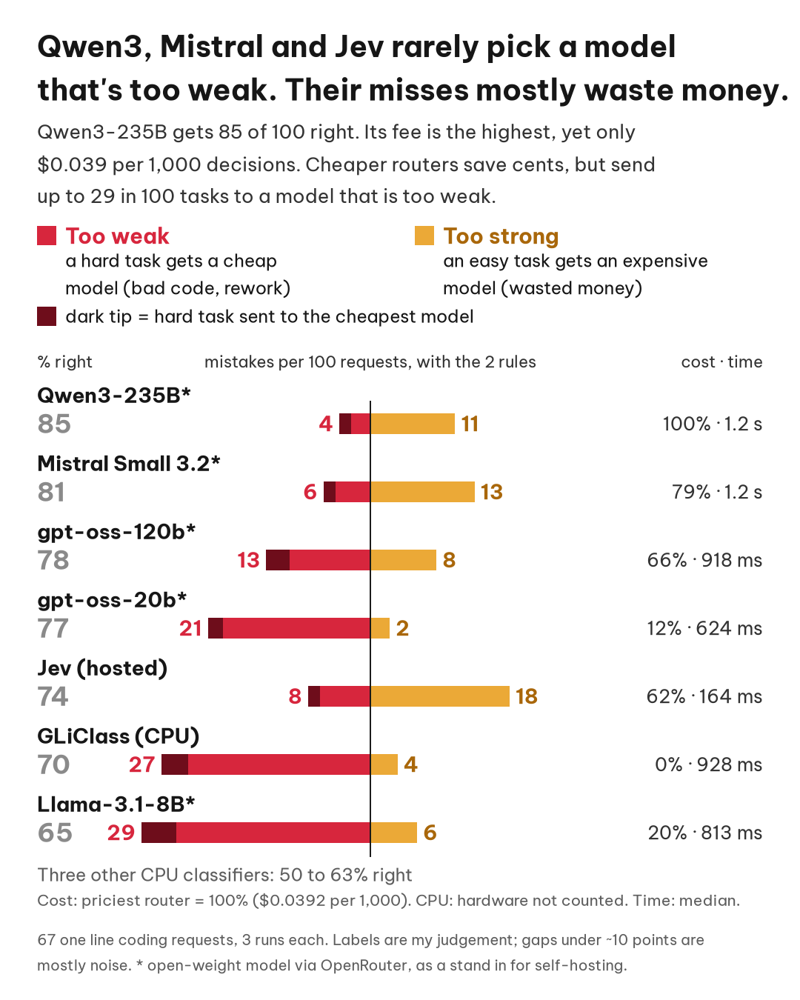
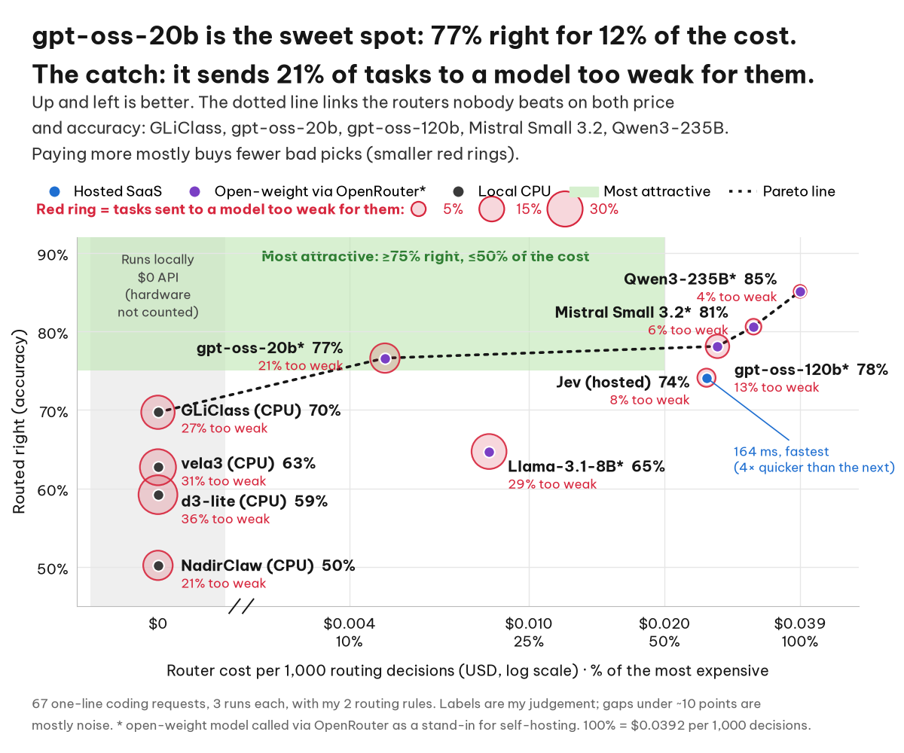

# DIY Auto mode: can a cheap router pick the right model?

This is the test behind my article **"DIY Auto mode: Jev, RouteLLM, Arch-Router and others"**.

The question is simple. Coding tools now have an "Auto" mode that picks a model for you. I wanted to know if I could build my own: put a cheap, fast router in front of every coding request and have it send the request to the right tier — **cheap**, **mid** or **frontier**. Send too much to frontier and you burn money. Send a hard task to cheap and you get a confident, broken answer. That second mistake is the one I care about most.

## The headline

**With my two rules added, Qwen3-235B sent 85% of my coding tasks to the tier I would have picked. Mistral Small 3.2 got 81%, gpt-oss-120b 78%, gpt-oss-20b 77% and Jev 74%. The small models that run locally on a CPU topped out at 70% (GLiClass). Qwen3, Mistral and Jev each sent only 4.5% of the hard tasks to the cheap tier (3 out of 66 decisions). Jev decides in about 160 ms; the open-weight LLMs take 0.6–1.2 seconds.**

So yes, a cheap router mostly works. But "mostly" is doing a lot of work in that sentence, and the test set is small. Read the caveats.



## What I tested

- **67 one-line coding requests** in [`queries.jsonl`](queries.jsonl), balanced on purpose: **23 cheap, 22 mid, 22 frontier**. The labels are my judgement, not measured task success.
- **10 routers**: Jev 1.14 (hosted), five open-weight LLMs called through OpenRouter (Qwen3-235B-A22B-2507, Mistral Small 3.2 24B, gpt-oss-120b, gpt-oss-20b, Llama-3.1-8B), and four small models running locally on CPU (GLiClass v4 edge, vela3-fast, d3-lite, NadirClaw DistilBERT). Arch-Router 1.5B and RouteLLM BERT were tested in earlier rounds and sit in the appendix of the report.
- **3 runs** of every query for every router.
- **With and without my two rules.** These are lines 7–8 of [`run_llm_v3.py`](run_llm_v3.py):
  1. If the user signals urgency or production impact (e.g. "urgent", "ASAP", production down, outage, customers blocked), choose frontier.
  2. If the change could ripple across the codebase (e.g. a major dependency or framework upgrade, a wide migration touching many files), choose frontier.

  The LLMs get the rules in their prompt. The decision models (Jev, GLiClass, vela3, d3) get two extra yes/no questions in the same call, and the rule fires above 0.5 ([`decision_common.py`](decision_common.py)).

The whole v3 round cost about $0.04 on OpenRouter.

## Results with my two rules

| Router | Routed right | Hard task sent to cheap (of 66) | p50 latency | $ per 1k decisions |
|---|---|---|---|---|
| Qwen3-235B-A22B-2507 (OpenRouter) | **85%** | 4.5% | 1235 ms | $0.039 |
| Mistral Small 3.2 24B (OpenRouter) | **81%** | 4.5% | 1178 ms | $0.031 |
| gpt-oss-120b (OpenRouter) | **78%** | 9.1% | 918 ms | $0.026 |
| gpt-oss-20b (OpenRouter) | **77%** | 6.1% | 624 ms | $0.005 |
| Jev 1.14 (OpenRouter) | **74%** | 4.5% | 164 ms | $0.024 |
| GLiClass v4 edge (local CPU) | **70%** | 10.6% | 928 ms | $0 |
| Llama-3.1-8B (OpenRouter) | **65%** | 13.6% | 813 ms | $0.008 |
| vela3-fast (local CPU) | **63%** | 18.2% | 1293 ms | $0 |
| d3-lite (local CPU) | **59%** | 15.2% | 2128 ms | $0 |
| NadirClaw DistilBERT + GLiClass rule checks (local CPU) | **50%** | 4.5% | 958 ms | $0 |

"Hard" means a frontier-labelled request: 22 queries × 3 runs = 66 decisions. Only Qwen3 vs Jev clears a paired bootstrap; with n = 67, most gaps under ~10 points are noise. The full tables (without rules, over/under-routing, consistency, calibration, licences) are in [`results_v3/REPORT.md`](results_v3/REPORT.md). The raw numbers behind every percentage are in [`results_v3/counts.json`](results_v3/counts.json).



## Some real prompts from the test set

| id | Request | My label | What happened |
|---|---|---|---|
| q07 | `Bump lodash from 4.17.20 to 4.17.21 in package.json.` | frontier | Every router said cheap, rules or not (NadirClaw said mid). A patch bump doesn't read as "could ripple across the codebase", so my rule as worded doesn't catch it. |
| q38 | `Design an idempotent payment webhook handler that survives retries, out-of-order events and partial failures.` | frontier | Correctness-critical distributed-systems design. |
| q48 | `URGENT!!! Production is down!!! ...the error says ModuleNotFoundError: No module named 'requests'. Please fix ASAP.` | frontier | The fix is trivial, but when I say urgent I want the best model. Without rules most routers said cheap or mid. With rules, every router said frontier. |

## The test set is a starting point

These are **one-line** requests with no repo context. Real prompts to a coding agent are longer: pasted stack traces, file contents, half a page of "here's what I already tried". That changes both accuracy and cost (Jev bills per input token). Treat these numbers as a first look, not a verdict. That's exactly why I want your prompts (see below).

## Rerun it

You need Python 3.11+ (I used 3.13) and an OpenRouter key.

```bash
python -m venv .venv && . .venv/bin/activate
pip install -r requirements.txt

export OPENROUTER_API_KEY=...      # your own key; never commit it
export RESULTS=results_v3          # where run_*.py write raw/*.jsonl

# Hosted routers
python run_jev_v3.py
python run_llm_v3.py qwen/qwen3-235b-a22b-2507 qwen3_235b rules 3
python run_llm_v3.py qwen/qwen3-235b-a22b-2507 qwen3_235b norules 3
#   same pattern for: mistralai/mistral-small-3.2-24b-instruct mistral_small32,
#   openai/gpt-oss-120b gptoss120b, openai/gpt-oss-20b gptoss20b,
#   meta-llama/llama-3.1-8b-instruct llama8b

# Local CPU routers: gli, vela, d3, nadir
python run_local.py gli 3

# Score and chart
python score_v3.py
cd results_v3 && python chart_errors.py && python chart_pareto.py
```

Environment variables, by name:

- `OPENROUTER_API_KEY`: required for Jev and the hosted LLMs.
- `RESULTS`: output folder for raw decisions (`results`, `results_v2` or `results_v3`).
- `QUERIES`: query file to use (default `queries.jsonl`).
- `ONLY`: comma-separated query ids to run a subset, e.g. `ONLY=q07,q48`.
- `VELA3_PATH`, `D3_LITE_PATH`: optional local folders for vela3-fast and d3-lite. If unset, the pinned revisions are downloaded into your normal Hugging Face cache.
- `HF_TOKEN`: optional, for faster Hugging Face downloads.
- `TORCH_THREADS`: CPU threads for `run_local.py` (default 8).
- `CHART_FONT_DIR`: optional folder with the Be Vietnam Pro `.ttf` files. Without it, the charts fall back to DejaVu Sans.
- `TITLE`, `FOOT`: chart title and footer for `chart_v3.py`.

**Arch-Router weights aren't in this repo.** The GGUF is 1.3 GB and has its own research licence. Download it yourself before running `run_arch.py`:

```bash
hf download katanemo/Arch-Router-1.5B.gguf Arch-Router-Q6_K.gguf --local-dir models
```

`make_queries.py` only regenerates the original v1 set (`queries_v1.jsonl`). It refuses to touch `queries.jsonl`, which is edited by hand.

## How to contribute

I want two things: **real, longer prompts** and **your routing rules**. Open a **pull request** or an **issue**, whichever is easier.

### Adding prompts

Add one JSON object per line to `queries.jsonl`, using these fields:

```json
{"id": "q68", "category": "hard_debug", "query": "<the full prompt, as you'd actually send it>", "label": "frontier", "rationale": "<one sentence: why this tier>", "source": "<your GitHub handle>"}
```

- `id`: next free number (`q68`, `q69`, ...).
- `category`: one of `trivial_edit`, `docs_question`, `bug_fix`, `refactor`, `architecture`, `hard_debug`, `agentic`, `transformation`, `adversarial_easy`, `adversarial_hard`, or suggest a new one.
- `query`: the real prompt. Long is good. Pasted errors and code are good. Strip anything private (names, keys, internal URLs).
- `label`: `cheap`, `mid` or `frontier`, meaning the cheapest tier that would reliably get it right.
- `rationale`: why you picked that tier.
- `source`: who added it.

If you'd rather not touch JSON, open an issue with the prompt, your tier and one line of why. I'll add it.

### Adding rules

A rule is one plain sentence that overrides difficulty, like my two above. In an issue or PR, give me:

1. **The rule**, one sentence: "If …, choose frontier/mid/cheap."
2. **Two or three prompts that should trigger it**, and one that looks similar but shouldn't.
3. **Why**: what goes wrong in your work when the router misses it.

In code, a rule goes in two places: a line in `POLICY` in `run_llm_v3.py` (for the LLMs) and a yes/no (`noul`) question in `QUESTIONS` in `decision_common.py`, plus a check in `apply_rules` (for the decision models). A good first one: a rule that actually catches q07, e.g. "any dependency or version change".

## Files

- `queries.jsonl`: the current 67-query test set. `queries_v1.jsonl`: the original 57.
- `run_*.py`: one runner per router. `local_backends.py`: the local CPU models.
- `score_v3.py`: scoring. `results_v3/`: report, summary, counts, raw decisions and charts.
- `results/`, `results_v2/`: the earlier rounds. `DESIGN.md`: the original plan.

## License

The code and data in this repo are MIT licensed (see [`LICENSE`](LICENSE)). The models have their own licences, listed in [`results_v3/REPORT.md`](results_v3/REPORT.md).

— David Graça
