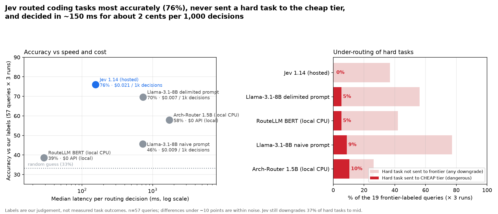

# Router test results: Jev vs Arch-Router vs RouteLLM vs small-LLM baseline
Run 2026-11-01 (Europe/Paris), 57 agentic-coding queries (`queries.jsonl`, 19 per label) × 3 runs per router. Routing = difficulty tier only (cheap / mid / frontier). Optional label-validation step NOT run.

**Takeaway:** Jev 1.14 was the most accurate router (76%), never sent a frontier-labeled task to the cheap tier, was the most self-consistent hosted router, and its probabilities were useful (98% accurate on the 71% of decisions it was ≥0.8 confident about) — at ~155 ms p50 and ~$0.02 per 1,000 decisions. Its main weakness: it is conservative-to-the-middle — 37% of hard tasks went to *mid*, not frontier. A cheap 8B LLM with a properly delimited prompt came second (70%), at ~5× the latency but ~⅓ the per-decision cost. The two open routers (Arch-Router, RouteLLM BERT) were not designed for difficulty routing and performed worst.

## Summary (from `summary.csv`)
| Router | Acc (all 57) | Acc (42 test) | Over-route | Under-route | Hard→cheap | Hard not→frontier | Cheap→frontier | p50 / p95 ms | $ per 1k decisions | Consistent 3/3 | Acc @conf≥0.8 (coverage) | ECE |
|---|---|---|---|---|---|---|---|---|---|---|---|---|
| Jev 1.14 (OpenRouter) | 76% | 75% | 9% | 15% | 0% | 37% | 0% | 155 / 270 | $0.0214 | 98% | 98% (71%) | 0.136 |
| Arch-Router 1.5B (local CPU) | 58% | 55% | 28% | 14% | 10% | 26% | 10% | 1722 / 2337 | $0 (local) | 100% | 70% (75%) | 0.288 |
| Llama-3.1-8B naive prompt (OpenRouter) | 46% | 45% | 9% | 46% | 9% | 77% | 0% | 723 / 1770 | $0.0094 | 81% | 49% (100%) | 0.418 |
| Llama-3.1-8B delimited prompt (OpenRouter) | 70% | 68% | 8% | 23% | 5% | 56% | 4% | 729 / 1368 | $0.0075 | 82% | 70% (100%) | 0.188 |
| RouteLLM BERT (local CPU) | 39% | 33% | 47% | 14% | 5% | 42% | 53% | 29 / 56 | $0 (local) | 100% | – (–) | – |

**Jev 1.14 (OpenRouter)** (rows = label cheap/mid/frontier, cols = predicted cheap/mid/frontier): `[[45, 12, 0], [5, 49, 3], [0, 21, 36]]`

**Arch-Router 1.5B (local CPU)** (rows = label cheap/mid/frontier, cols = predicted cheap/mid/frontier): `[[36, 15, 6], [9, 21, 27], [6, 9, 42]]`

**Llama-3.1-8B naive prompt (OpenRouter)** (rows = label cheap/mid/frontier, cols = predicted cheap/mid/frontier): `[[42, 15, 0], [34, 23, 0], [5, 39, 13]]`

**Llama-3.1-8B delimited prompt (OpenRouter)** (rows = label cheap/mid/frontier, cols = predicted cheap/mid/frontier): `[[44, 11, 2], [7, 50, 0], [3, 29, 25]]`

**RouteLLM BERT (local CPU)** (rows = label cheap/mid/frontier, cols = predicted cheap/mid/frontier): `[[6, 21, 30], [0, 27, 30], [3, 21, 33]]`

Columns: *Over-route* = predicted tier above label; *Under-route* = below label; *Hard→cheap* = share of frontier-labeled decisions sent to cheap (the dangerous case); *Hard not→frontier* = frontier-labeled decisions sent to cheap or mid; *$ per 1k* = actual OpenRouter `usage.cost` averaged ×1000; *Consistent 3/3* = queries with identical tier in all 3 runs; *ECE* = expected calibration error (5 bins) of the top-tier probability. Jev and Arch-Router Brier (3-class): 0.229 vs 0.527. Adversarial subset (6 queries, majority vote): Jev 3/6, Llama naive 3/6, Llama delimited 2/6, Arch 1/6, RouteLLM 1/6.

## The 3 most telling misroutes (majority vote over 3 runs)
1. **q51 "small thing: make the cache thread-safe"** (label frontier: concurrency correctness) → Jev **mid**, Arch-Router **cheap**, Llama naive **cheap**, Llama delimited **cheap**, RouteLLM **mid**. Casual wording fooled every router; three of them sent a concurrency task to the cheap tier. Nobody chose frontier.
2. **q38 "Design an idempotent payment webhook handler that survives retries, out-of-order events and partial failures"** (frontier) → everyone **frontier** except RouteLLM BERT → **cheap**. Shows RouteLLM's Chatbot-Arena-trained win-rate score doesn't track coding difficulty.
3. **q52 "quick fix pls: sometimes balances are off by a cent after transfers"** (frontier: money/rounding/race) → Jev **frontier**, Llama naive **frontier**, Llama delimited **mid**, RouteLLM **mid**, Arch-Router **cheap**. Jev saw through the casual framing here; Arch-Router did not.
(Honourable mention, q33 multi-tenant Postgres isolation design, frontier → Jev/Arch/RouteLLM/Llama-naive all **mid**.)

## Setup per router (exact)
- **Jev 1.14** via OpenRouter System One API: `POST https://openrouter.ai/api/v1/systemone`, model `typesafe/jev-1.14` (served as `typesafe/jev-1.14-20261014`). One `choice` question `tier` with the three tier descriptions from `common.py` as criteria; state = `{setting, request}`. Returns choice + per-option probabilities + confidence natively. ~504 input tokens/call (mostly the criteria), output free. (OpenRouter also lists `typesafe/jev-router`, a chat auto-router built on Jev that picks the downstream model itself — not tested, since it bills the downstream model and hides the tier decision.)
- **Arch-Router-1.5B**: official `katanemo/Arch-Router-1.5B.gguf` Q6_K via llama-cpp-python 0.3.36, 8 threads, greedy, `max_tokens=32`, the model card's prompt, routes = cheap/mid/frontier with the same descriptions. Route probabilities from next-token logits after `{'route': '` (run 0 only, not timed). It answered `other` on 8 queries (mostly docs/design questions); those were mapped to **mid** (counted as the 14% "parse fail").
- **RouteLLM BERT**: checkpoint `routellm/bert_gpt4_augmented`, scored with code identical to `routellm.routers.BERTRouter.calculate_strong_win_rate` (reimplemented in `run_bert.py` to avoid the package's heavy deps). Win-rate → tiers with thresholds fit on a held-out calibration split (15 queries, 5 per label, seed 42; grid search maximizing accuracy, tie-break fewest under-routes): **cheap < 0.308 ≤ mid < 0.428 ≤ frontier**. "Acc (42 test)" is the honest number for it (33% = chance). No 3-tier confidence → no calibration metrics.
- **Small-LLM baseline**: `meta-llama/llama-3.1-8b-instruct` via OpenRouter chat completions, temperature 0, max 40 tokens, JSON `{tier, confidence}` with self-reported confidence. Two prompt variants:
  - *naive*: query as the raw user message → the model *answered the task instead of classifying* on 16% of calls (wrote code, ADRs, scripts); those fell back to mid.
  - *delimited*: query wrapped in `<request>` tags with "do NOT answer it" → 0 parse failures. This is the fair baseline.
  Provider varied per call (Novita/DeepInfra/…), which likely explains the 82% run-to-run consistency despite temperature 0.

## Spend
OpenRouter key usage after all runs: **$0.0066** total (logged per-call sum $0.0066: Jev $0.0037, Llama naive $0.0016, Llama delimited $0.0013, plus a few smoke-test calls). Well under the $1 cap. Local routers: $0 API.

## Caveats
- **Labels are our judgement**, not measured outcomes; "accuracy" means agreement with us. The validation step (run a subset through cheap and frontier models) was not run.
- **Small n**: 57 queries; a ±10-point gap is within noise (95% CI on 76% ≈ ±11 pts). Jev vs delimited-Llama (76% vs 70%) is suggestive, not conclusive. Jev's lead on calibration, the dangerous case and consistency is clearer.
- **Prompt sensitivity**: all prompt-based routers used one set of tier descriptions; no prompt tuning was done for any router. Jev's choice criteria were the same text.
- Arch-Router and RouteLLM were **not built for difficulty routing** (Arch = domain/action preferences; RouteLLM = trained on 2024 GPT-4-vs-Mixtral Chatbot Arena preferences). Their poor scores say "wrong tool for this job", not "bad models". RouteLLM's recommended `mf` router needs OpenAI embeddings (no key) and `causal_llm` needs a GPU; only `bert` was tested.
- **Latency**: from the test machine (Europe) to OpenRouter; Jev is served from the US. Local latencies on 8 vCPU, no GPU; Arch-Router's ~1.7 s would drop sharply on GPU. RouteLLM BERT 29 ms is CPU inference only.
- Queries are short one-liners with no repo context; real agent prompts are longer (affects Jev cost, which is per input token, and possibly accuracy).
- "Router cost per 1k" is the routing decision cost only; downstream savings depend on your model prices.

## Files
- `results/raw/*.jsonl` — every decision (router, run, id, pred, probs/confidence, latency, cost). No secrets logged.
- `results/summary.csv`, `results/summary.json` (incl. confusion matrices, BERT thresholds, calibration ids), `results/per_query_majority.json`
- `results/chart.png`
- Harness: `common.py`, `run_jev.py`, `run_arch.py`, `run_bert.py`, `run_llm.py`, `run_llm_v2.py`, `score.py`, `chart.py`; venv in `.venv`, model in `models/`.
Re-run: `.venv/bin/python run_<router>.py` then `.venv/bin/python score.py && .venv/bin/python chart.py`.
