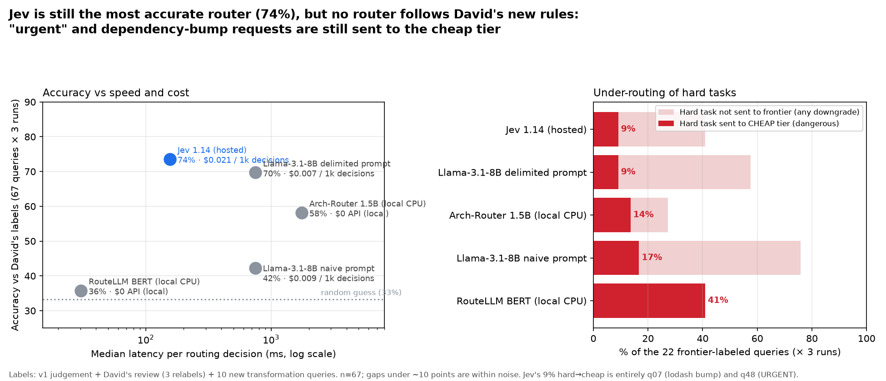

# Router test v2: David's relabels + 10 transformation queries
Run 2026-11-01 ~16:20 (UTC+1). 67 queries (`queries.jsonl`; original kept as `queries_v1.jsonl`) × 3 runs × 4 routers (+ naive-prompt Llama variant). Same router setup, prompts and tier descriptions as v1 (`results/REPORT.md`). Label validation still not run.

**Takeaway:** Jev 1.14 is still the most accurate router (74%) and got 9/10 new transformation queries right, but its dangerous under-routing rose from 0% to 9%. All of that comes from two of David's relabels, q07 (lodash bump) and q48 ("URGENT!!! production down"), which Jev sends to *cheap* in all 3 runs. None of the routers was told David's rules ("urgent → frontier", "dependency bumps can be big"), so none follows them. That is a policy gap, not a model-ability gap (see recommendation).

## v1 → v2 summary (`summary.csv`)
| Router | Accuracy v1 → v2 | v2 test split | Hard→cheap v1 → v2 | Hard not→frontier | Over / under (v2) | p50 / p95 ms | $ per 1k decisions | Consistent 3/3 | Acc @conf≥0.8 (coverage) | ECE |
|---|---|---|---|---|---|---|---|---|---|---|
| Jev 1.14 (OpenRouter) | 76% → **74%** | 74% | 0% → 9% | 41% | 10% / 16% | 156 / 251 | $0.021 | 98% | 94% (72%) | 0.121 |
| Llama-3.1-8B delimited prompt | 70% → 70% | 69% | 5% → 9% | 58% | 8% / 22% | 750 / 1350 | $0.007 | 82% | 70% (100%) | 0.187 |
| Arch-Router 1.5B (local CPU) | 58% → 58% | 56% | 10% → 14% | 27% | 28% / 13% | 1757 / 2539 | $0 | 100% | 69% (73%) | 0.279 |
| Llama-3.1-8B naive prompt | 46% → 42% | 45% | 9% → 17% | 76% | 13% / 45% | 748 / 1851 | $0.009 | 78% | 47% (100%) | 0.434 |
| RouteLLM BERT (local CPU) | 39% → 36% | 29% | 5% → 41% | 41% | 40% / 24% | 30 / 94 | $0 | 100% | – | – |

Confusion matrices, calibration split ids and thresholds are in `summary.json`.

## What changed and why
- **Relabels (David):** q07 lodash bump cheap→**frontier**; q48 URGENT production down cheap→**frontier**; q24 rounding test mid→**cheap**.
  - q07: every LLM-style router said *cheap*; RouteLLM said frontier.
  - q48: only Arch-Router said frontier.
  - q24: Llama naive said cheap; Jev and Llama delimited said mid.
  - Net effect: every router lost points on q07, which pushed all hard→cheap rates up.
- **New queries (10, source=david_v2):** mostly cheap/mid transformations. These helped Jev and the delimited Llama (9/10 each), which offset the relabel losses.
- **RouteLLM thresholds refit** with the same method: stratified held-out split, 5 per label, seed 42, grid search maximizing accuracy with fewest under-routes as tie-break. Because the labels changed, the split changed (`calib_ids` in `summary.json`).
  - New thresholds: cheap < 0.4230 ≤ mid < 0.4275 ≤ frontier.
  - The mid band is almost empty, so the fit is degenerate: the BERT score barely separates tiers on these prompts. That explains the 41% hard→cheap and the 29% test-split accuracy, which is below chance.
- **Reuse:** v1 raw decisions for q01–q57 were reused (only labels changed). q58–q67 were run fresh, 3 runs × every router. Jev's first pass at q58–q67 hit a network SSL error. I added a retry loop and re-ran that batch only; no answers were mixed.

## q48 "URGENT!!! Production is down!!! …No module named 'requests'" (now frontier)
| Router | 3 runs | Confidence |
|---|---|---|
| Jev | cheap, cheap, cheap | 0.85 / 0.83 / 0.88 |
| Arch-Router | frontier ×3 | 1.0 (run 1) |
| Llama delimited | mid ×3 | 0.8 self-reported |
| Llama naive | cheap ×3 | 0.95 |
| RouteLLM BERT | cheap ×3 | – |

Jev judges the *task* (adding a missing dependency is trivial), which matches the v1 intent but not David's user-intent rule.

## New transformation queries (majority of 3 runs)
| id | Query (short) | Label | Jev | Arch | Llama naive | Llama delim. | RouteLLM |
|---|---|---|---|---|---|---|---|
| q58 | Translate README "Getting started" to French | cheap | cheap | mid | cheap | cheap | frontier |
| q59 | Reword a paragraph to be more concise | cheap | cheap | cheap | cheap | cheap | frontier |
| q60 | Rewrite release notes for non-technical audience | cheap | cheap | mid | mid | cheap | cheap |
| q61 | Create a PDF report from REPORT.md (tables + chart) | cheap | **mid** | mid | mid | cheap | frontier |
| q62 | Export architecture.md to a 10-slide PowerPoint with notes | mid | mid | mid | cheap | mid | frontier |
| q63 | Translate en.json (~300 strings) into 5 languages, keep {placeholders}/ICU plurals | mid | mid | mid | mid | **frontier** | frontier |
| q64 | Convert one Vue 3 component to React + TS | mid | mid | mid | cheap | mid | frontier |
| q65 | Convert whole Vue 2 app (~40 components, Vuex, router, mixins) to React + Redux Toolkit | frontier | frontier | frontier | frontier | frontier | frontier |
| q66 | Convert docs/api.md into an OpenAPI 3.1 spec | mid | mid | mid | cheap | mid | frontier |
| q67 | Turn 20 meeting-note bullets into a short status email | cheap | cheap | mid | mid | cheap | cheap |
| | **Correct** | | **9/10** | 6/10 | 4/10 | **9/10** | 3/10 |

Label judgement calls: PDF export = cheap (tooling, little reasoning; could be mid); UI-strings translation = mid (placeholder/ICU-plural preservation); OpenAPI conversion = mid (schema inference). Full rationales are in `queries.jsonl`.

## Recommendation (not run)
Treat David's two rules as **policy**, not difficulty. Add separate Jev questions in the same call, e.g. a `noul` "the user signals urgency or production impact" and a `noul` "the change may require code changes across the codebase (e.g. major dependency upgrade)", and force frontier when either is above a threshold. Output tokens are free and the input cost is about the same, so this adds essentially nothing per decision. Alternatively, put the rules into the tier descriptions for all routers. Either would be a fair v3 test.

## Spend
New OpenRouter spend for v2 ≈ **$0.0013** (Jev ≈ $0.0006, Llama variants ≈ $0.0004, plus the failed-then-retried Jev batch). Cumulative key usage for v1 and v2: **$0.0079**. Local routers $0.

## Caveats
Same as v1 (judgement labels, small n with ±10-point noise, no prompt tuning, Arch/RouteLLM not built for difficulty routing, Europe→US latency, one-liner queries). In addition, the relabels encode user-intent rules that no router was given, so the v2 under-routing numbers partly measure a missing instruction.

## Files
`results_v2/raw/*.jsonl` (merged v1+new decisions), `results_v2/new/raw/` (fresh q58–q67 only), `summary.csv`, `summary.json`, `per_query_majority.json`, `chart.png`, this report. Queries: `queries.jsonl` (v2) and `queries_v1.jsonl` (original).
Re-run: `RESULTS=results_v2 .venv/bin/python score.py`; the chart uses env vars TITLE/YLAB/XLAB/FOOT in `chart.py`.
