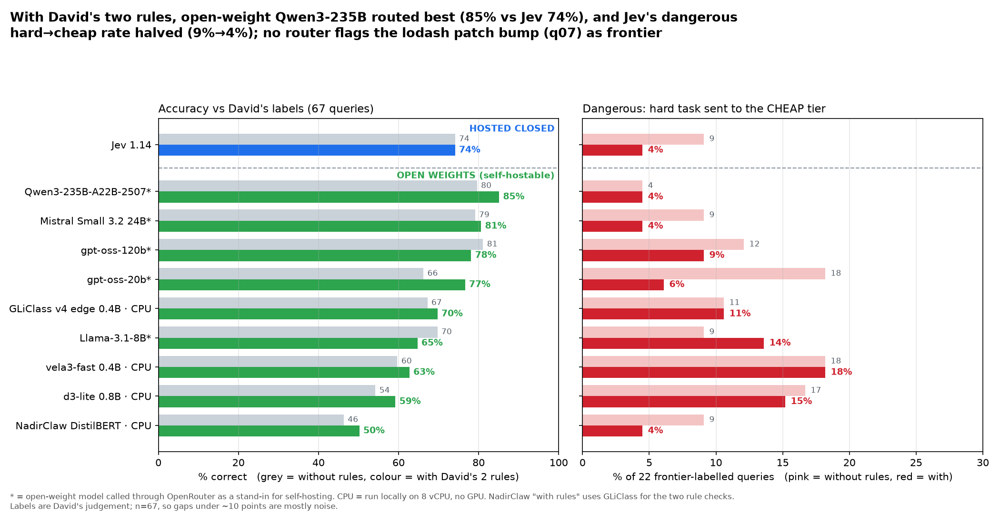

# Router test v3: David's policy rules + hosted-closed vs open-weight routers
Run 2026-11-01, ~16:35–16:55 (UTC+1). `queries.jsonl` v2 (67 queries, David's labels: 23 cheap / 22 mid / 22 frontier). 3 runs for every router, including the local ones. Label validation still not run.

**Takeaway:**
- **With David's two rules, an open-weight model routed best.** Qwen3-235B-A22B-2507 scored 85% vs Jev's 74% (paired bootstrap +10.4 pts, 95% CI +1.5 to +19.4). Mistral Small 3.2 (81%) and gpt-oss-120b (78%) are also ahead of Jev, but within noise.
- **The rules cut Jev's dangerous hard→cheap rate in half (9% → 4.5%)**, but its accuracy stayed at 74%: the "ripple" check also pushed 5 mid tasks to frontier.
- **Jev is still by far the fastest hosted option**, at 164 ms p50 vs 0.6–1.2 s for the open-weight LLMs over OpenRouter, and has the best-calibrated probabilities (ECE 0.115).
- **The small open decision models that run on this CPU are clearly weaker.** The best is GLiClass v4 edge at 70% with rules and ~0.9 s per call.
- **q48 (URGENT) now goes to frontier for every router with rules. q07 (lodash 4.17.20→4.17.21) goes to cheap for every router.** It is a *patch* bump, so no model judged that it "could ripple across the codebase". David's rule as written doesn't capture "any dependency bump" (see recommendation).

## How the rules were applied
- **Decision models (Jev, vela3-fast, d3-lite, GLiClass v4 edge):** one System One call with three questions, using the same wording for all four (`decision_common.py`):
  - `tier`: a choice between cheap / mid / frontier, with the v1/v2 tier descriptions.
  - `urgent`: noul (yes/no) "The user signals urgency or production impact (for example 'urgent', 'ASAP', production is down, an outage, customers are blocked)."
  - `ripple`: noul "The requested change could ripple across the codebase (for example a major dependency or framework upgrade, or a wide migration touching many files)."
  - **With rules:** frontier if P(urgent) > 0.5 or P(ripple) > 0.5, else `tier`. **Without rules:** `tier` from the same call. For Jev this reproduces v2 exactly (74%, 9%).
  - GLiClass has no native System One endpoint. It was driven with its model card's documented mapping: each question is one pass, the instructions are the prompt, the options are the labels, and a noul is P(yes) over yes/no.
- **LLM classifiers (gpt-oss-20b/120b, Qwen3-235B, Mistral Small 3.2, Llama-3.1-8B):**
  - **Without rules:** the v2 delimited prompt (the query wrapped in `<request>` tags, "do not answer it", JSON tier and confidence), temperature 0.
  - **With rules:** the same prompt plus a "Policy rules (they override difficulty)" block stating the two rules.
  - gpt-oss used `reasoning.effort=low`.
  - Llama-3.1-8B without rules reuses the v2 raw decisions (identical prompt).
- **NadirClaw DistilBERT** is a fixed 3-class classifier (simple→cheap, medium→mid, complex→frontier) and can't take questions. Its "with rules" row borrows GLiClass's two rule answers. That is a hybrid, labelled as such.

## Results

### Hosted closed

| Router | Rules | Runs | Accuracy | Hard→cheap (of 66) | Hard not→frontier | Over / under | p50 / p95 ms | $ per 1k | Consistent 3/3 | ECE | q07 | q48 |
|---|---|---|---|---|---|---|---|---|---|---|---|---|
| Jev 1.14 (OpenRouter) | no rules | 3 | **74%** | 9.1% | 41% | 10% / 15% | 164 / 236 | $0.0243 | 99% | 0.115 | cheap | cheap |
| Jev 1.14 (OpenRouter) | rules | 3 | **74%** | 4.5% | 18% | 18% / 8% | 164 / 236 | $0.0243 | 99% | – | cheap | frontier |

### Open weights

| Router | Rules | Runs | Accuracy | Hard→cheap (of 66) | Hard not→frontier | Over / under | p50 / p95 ms | $ per 1k | Consistent 3/3 | ECE | q07 | q48 |
|---|---|---|---|---|---|---|---|---|---|---|---|---|
| gpt-oss-120b (via OpenRouter) | no rules | 3 | **81%** | 12.1% | 17% | 3% / 15% | 908 / 2375 | $0.0204 | 91% | 0.124 | cheap | cheap |
| gpt-oss-120b (via OpenRouter) | rules | 3 | **78%** | 9.1% | 17% | 8% / 13% | 918 / 2510 | $0.0257 | 87% | – | cheap | frontier |
| gpt-oss-20b (via OpenRouter) | no rules | 3 | **66%** | 18.2% | 76% | 4% / 29% | 568 / 1529 | $0.0038 | 96% | 0.258 | cheap | cheap |
| gpt-oss-20b (via OpenRouter) | rules | 3 | **77%** | 6.1% | 41% | 2% / 21% | 624 / 1498 | $0.0047 | 93% | – | cheap | frontier |
| Qwen3-235B-A22B-2507 (via OpenRouter) | no rules | 3 | **80%** | 4.5% | 23% | 13% / 7% | 1024 / 2436 | $0.0335 | 97% | 0.144 | cheap | mid |
| Qwen3-235B-A22B-2507 (via OpenRouter) | rules | 3 | **85%** | 4.5% | 9% | 11% / 4% | 1235 / 2960 | $0.0392 | 97% | – | cheap | frontier |
| Mistral Small 3.2 24B (via OpenRouter) | no rules | 3 | **79%** | 9.1% | 17% | 15% / 6% | 1202 / 2256 | $0.0246 | 97% | 0.139 | cheap | cheap |
| Mistral Small 3.2 24B (via OpenRouter) | rules | 3 | **81%** | 4.5% | 14% | 13% / 6% | 1178 / 2096 | $0.0309 | 100% | – | cheap | frontier |
| Llama-3.1-8B delimited (via OpenRouter) | no rules | 3 | **70%** | 9.1% | 58% | 8% / 22% | 750 / 1350 | $0.0073 | 82% | 0.187 | cheap | mid |
| Llama-3.1-8B delimited (via OpenRouter) | rules | 3 | **65%** | 13.6% | 67% | 6% / 29% | 813 / 1393 | $0.0080 | 78% | – | cheap | frontier |
| vela3-fast 0.4B (local CPU) | no rules | 3 | **60%** | 18.2% | 55% | 4% / 36% | 1293 / 1708 | $0 (local) | 100% | 0.279 | cheap | mid |
| vela3-fast 0.4B (local CPU) | rules | 3 | **63%** | 18.2% | 45% | 6% / 31% | 1293 / 1708 | $0 (local) | 100% | – | cheap | frontier |
| d3-lite 0.8B (local CPU) | no rules | 3 | **54%** | 16.7% | 80% | 3% / 43% | 2128 / 2879 | $0 (local) | 94% | 0.248 | cheap | mid |
| d3-lite 0.8B (local CPU) | rules | 3 | **59%** | 15.2% | 61% | 4% / 36% | 2128 / 2879 | $0 (local) | 94% | – | cheap | frontier |
| GLiClass v4 edge 0.4B (local CPU) | no rules | 3 | **67%** | 10.6% | 55% | 3% / 30% | 928 / 1320 | $0 (local) | 99% | 0.328 | cheap | mid |
| GLiClass v4 edge 0.4B (local CPU) | rules | 3 | **70%** | 10.6% | 45% | 3% / 27% | 928 / 1320 | $0 (local) | 97% | – | cheap | frontier |
| NadirClaw DistilBERT (local CPU) | no rules | 3 | **46%** | 9.1% | 73% | 28% / 25% | 28 / 55 | $0 (local) | 100% | 0.49 | mid | cheap |
| NadirClaw DistilBERT (local CPU) | rules (via GLiClass rule checks) | 3 | **50%** | 4.5% | 59% | 29% / 21% | 958 / 1345 | $0 (local) | 99% | – | mid | frontier |

### Appendix

| Router | Rules | Runs | Accuracy | Hard→cheap (of 22) | Hard not→frontier | Over / under | p50 / p95 ms | $ per 1k | Consistent 3/3 | ECE | q07 | q48 |
|---|---|---|---|---|---|---|---|---|---|---|---|---|
| Arch-Router 1.5B (appendix; licence) | no rules (v2, majority vote) | 3 | **58%** | 14% | 27% | – / – | – | – | – | – | cheap | frontier |
| RouteLLM BERT (appendix; below chance) | no rules (v2, majority vote) | 3 | **36%** | 41% | 41% | – / – | – | – | – | – | frontier | cheap |

ECE is the calibration error of the no-rules tier confidence: route probabilities for decision models, self-reported confidence for LLMs. The rules override confidence, so the with-rules rows have no ECE. Local latencies were measured with nothing else using the CPU. The three-question decision models make 3 encoder passes per call; NadirClaw makes one.

## Effect of the rules
- **q48 "URGENT!!! Production is down… No module named 'requests'"** (frontier): every router went to **frontier** with rules. Without rules, Jev, gpt-oss-120b, gpt-oss-20b, Mistral and NadirClaw said cheap; Qwen3, Llama, vela3, d3 and GLiClass said mid. The urgency check is reliable: Jev P(urgent) > 0.5 on q48, q41 and q45 only, all frontier-labelled.
- **q07 "Bump lodash from 4.17.20 to 4.17.21"** (frontier): still **cheap** for every router with rules, except NadirClaw (mid). Jev P(ripple) was 0.12, GLiClass 0.00, vela3 0.28. A patch bump isn't a "major dependency upgrade", so the models applied the rule as worded. To hit David's intent, the rule needs to say "any dependency or version change", or be a plain keyword rule on package manifests. Not run.
- **Jev's ripple check is broad.** It fired on 17 queries:
  - 12 frontier-labelled: it rescued q26, q30, q31 and q33 from mid.
  - 5 mid-labelled (q27, q29, q32, q39, q55, i.e. multi-file but pattern-based work), which were pushed to frontier.
  - Net: under-routing 15% → 8%, over-routing 10% → 18%, accuracy unchanged.
  - The local decision models fired the ripple check far less often (4–5 queries), so the rules helped them less.
- **LLMs:** the rules helped gpt-oss-20b most (66% → 77%; hard→cheap 18% → 6%), then Qwen3 (+5) and Mistral (+1.5). They slightly hurt gpt-oss-120b (−3) and Llama-3.1-8B (−5; hard→cheap 9% → 14%), where the extra text confused the 8B model.

## Best open-weight option vs Jev
- **Best overall: Qwen3-235B-A22B-2507 with rules.**
  - 85% accuracy, 4.5% hard→cheap, 9% hard not sent to frontier, 97% consistent.
  - Trade-offs vs Jev: ~1.2 s vs 0.16 s p50 over OpenRouter, $0.039 vs $0.024 per 1k decisions.
  - Self-hosting it needs a multi-GPU server (235B total / 22B active parameters, roughly 4×80 GB GPUs at FP8). Not possible on this box.
- **Best small self-hostable model: gpt-oss-20b with rules.** 77% (+3 vs Jev), 6% hard→cheap, $0.0047 per 1k via OpenRouter. Self-hosting fits on one ~16–24 GB GPU. Its weakness: 41% of hard tasks are not sent to frontier.
- **Mistral Small 3.2 24B with rules:** 81%, 4.5% hard→cheap, 100% consistent. One 48–80 GB GPU, or ~24 GB quantized.
- **Best that runs on this CPU box: GLiClass v4 edge with rules.** 70%, 11% hard→cheap, ~0.9 s p50 for 3 questions. vela3-fast (63%, ~1.3 s) and d3-lite (59%, ~2.1 s, slow fallback kernels on CPU) are behind it. NadirClaw is very fast (28 ms) but only 46–50%.
- The latencies for OpenRouter-hosted open models come from someone else's GPUs. A self-hosted deployment could be much faster or slower depending on the hardware.

## Licences (checked on Hugging Face model cards)
| Model | Licence |
|---|---|
| Jev 1.14 | Proprietary hosted API (TypeSafe / OpenRouter terms) |
| gpt-oss-20b, gpt-oss-120b | Apache-2.0 |
| Qwen3-235B-A22B-Instruct-2507 | Apache-2.0 |
| Mistral-Small-3.2-24B-Instruct-2506 | Apache-2.0 |
| Llama-3.1-8B-Instruct | Llama 3.1 Community License (custom; attribution and acceptable-use terms; extra licence needed above 700M MAU) |
| GLiClass v4 edge | Apache-2.0 (base DeBERTa-v3-large: MIT) |
| vela3-fast | Apache-2.0 (base UltraBERT-380M: Apache-2.0) |
| d3-lite | Apache-2.0 (base Qwen3.5-0.8B: Apache-2.0) |
| NadirClaw DistilBERT | Apache-2.0 |
| Arch-Router 1.5B (appendix) | Katanemo research licence (commercial use needs a separate licence) |
| RouteLLM BERT checkpoint (appendix) | No licence on the model card (RouteLLM code is Apache-2.0) |

## Spend
OpenRouter v3 ≈ **$0.044**:

| Router | Cost |
|---|---|
| Jev | $0.0049 |
| Qwen3-235B | $0.0146 |
| Mistral Small 3.2 | $0.0112 |
| gpt-oss-120b | $0.0093 |
| gpt-oss-20b | $0.0017 |
| Llama-3.1-8B (rules) | $0.0016 |
| Smoke tests | <$0.001 |

Cumulative key usage across v1–v3 is $0.052, under the $2 cap. Local models: $0.

## Caveats
- **Labels:** David's judgement, not measured task success. n = 67, so most gaps under ~10 points are noise. Only Qwen3 vs Jev with rules clears the paired bootstrap.
- **The rules were applied as worded:**
  - The noul wording is mine.
  - The 0.5 threshold was not tuned.
  - Jev's ripple question is broad; a stricter wording or a higher threshold would trade q26/q30/q31/q33 against q27/q29/q32/q39/q55.
- **Over OpenRouter, providers vary per call.** That explains why the LLMs aren't 100% consistent at temperature 0.
- **Open-weight via OpenRouter ≠ self-hosted:** latency and cost depend on your hardware.
- **Local CPU models:** d3-lite ran on slow reference kernels (no `flash-linear-attention` or `causal_conv1d` on CPU). vela3-fast ran its decision backbone only, without adapters, which its card says gives identical decisions. GLiClass emits near-0/1 probabilities, hence its high ECE (0.328).
- **Same prompt for everyone:** the tier descriptions were not tuned per model. One-line queries without repo context.

## Files
- `results_v3/summary.csv`, `results_v3/summary.json`, `results_v3/counts.json` (raw integer counts; the table and charts round once from these), `results_v3/per_query_majority.json`, `results_v3/chart.png`, `results_v3/REPORT.md`
- `results_v3/raw/*.jsonl`: every decision, including P(urgent)/P(ripple) for decision models. No secrets.
- Code: `decision_common.py` (shared questions and rule), `run_jev_v3.py`, `run_llm_v3.py`, `local_backends.py`, `run_local.py`, `score_v3.py`, `chart_v3.py`.
